 

 

> *"Simplicity is prerequisite for reliability."*  
> **Edsger W. Dijkstra**

(old account inaccessible)

---

## 👋 About Me

I build software that people actually use. I'm a high school developer who founded an AI startup, writes software for my town, and gave a TEDx talk. I learn a tool by making something real with it, then keep what works.

| 🎯 Focused on | 🛠️ Building | 🔐 Interested in |
|:---:|:---:|:---:|
| Shipping real products | AI agent tooling | Agent safety & security |
| Clean, readable code | Developer tools | Software archaeology |
| Clear user problems | Civic & health tech | Accessibility |

---

## 💻 Tech Stack

**Languages & Core**

 &nbsp;
 &nbsp;
 &nbsp;
 &nbsp;
 &nbsp;

**Frameworks & Platforms**

 &nbsp;
 &nbsp;
 &nbsp;
 &nbsp;
 &nbsp;
 &nbsp;

**Tools**

 &nbsp;
 &nbsp;
 &nbsp;
 &nbsp;
 &nbsp;

---

## 🚀 Shipped Products

| Project | What it is |
|:--|:--|
| **[Flowzco](https://flowzco.com)** | The operating system for AI assistants: a marketplace, creator studio and dashboard, with Mac and Windows apps. |
| **TOG Fix** | A civic app where Town of Greenburgh residents report infrastructure problems straight to the town. |
| **[UCPGlobal](https://ucpglobal.com)** | Production site for a precision-nutrition platform that turns blood biomarkers into meal plans. |
| **Cryvanta** | A Chrome extension that tracks crypto from the browser toolbar. |
| **Nexus Wallet** *(in development)* | A zero-knowledge identity wallet that proves facts about you without exposing your data. |

---

## 🧰 Open Source

### 🛡️ AI agent safety
| Repo | Description |
|:--|:--|
| [**agentgate**](https://github.com/rohancoding5/agentgate) | A checkpoint between AI agents that screens every message for prompt injection, leaked secrets and out-of-bounds tool calls. |
| [**agent-gauntlet**](https://github.com/rohancoding5/agent-gauntlet) | Puts an agent through adversarial situations and scores how well it holds up. |

### 🧭 Agent context & orchestration
| Repo | Description |
|:--|:--|
| [**handoff**](https://github.com/rohancoding5/handoff) | A planner model splits a job into subtasks and hands each to a worker model, on any provider. |
| [**plangraph**](https://github.com/rohancoding5/plangraph) | Turns a vague request into a dependency graph of small, testable tasks. |
| [**worktree-pool**](https://github.com/rohancoding5/worktree-pool) | Gives each AI coding agent its own git worktree and warns when two collide. |
| [**contextscope**](https://github.com/rohancoding5/contextscope) | Picks the context a task needs from file activity, import graphs and git history. |
| [**trimctx**](https://github.com/rohancoding5/trimctx) | Works out which context an agent really needs and cuts the rest. |
| [**mcpforge**](https://github.com/rohancoding5/mcpforge) | Generates a working MCP server from an OpenAPI spec or TypeScript functions. |

### 🔎 Codebase detective tools
| Repo | Description |
|:--|:--|
| [**casefile**](https://github.com/rohancoding5/casefile) | Describe a bug symptom and it investigates the repo like a detective. |
| [**whyfile**](https://github.com/rohancoding5/whyfile) | Explains why a piece of code exists from its commits, issues and pull requests. |
| [**codeatlas**](https://github.com/rohancoding5/codeatlas) | Maps a repo by domain dependencies and shows what breaks if you delete a file. |
| [**codedig**](https://github.com/rohancoding5/codedig) | Digs up code nobody understands anymore, using real references and history. |
| [**repopulse**](https://github.com/rohancoding5/repopulse) | Grades a repo's health across docs, tests, CI, releases and upkeep. |

### ♿ Accessibility
| Repo | Description |
|:--|:--|
| [**clearcheck**](https://github.com/rohancoding5/clearcheck) | Explains axe-core violations in plain language, tied to the real WCAG criteria. |

---

## 📫 Connect With Me

 

