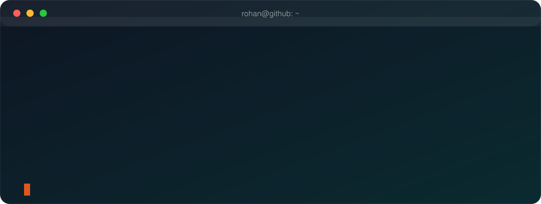

 

 

  

> *"Simplicity is prerequisite for reliability."*  
> **Edsger W. Dijkstra**

(old account inaccessible)

## 👋 About Me

I'm a high school developer who learns by building real things. I like clear problems, clean code, and software that people actually use.

| 🎯 Focused on | 🛠️ Building | 🔐 Interested in |
|:---:|:---:|:---:|
| Building real products | AI agent tooling | Agent safety & security |
| Clean, readable code | Developer tools | Software archaeology |
| Clear user problems | Web apps & APIs | Accessibility |

## 💻 What I Know

**Languages**

 &nbsp;
 &nbsp;
 &nbsp;
 &nbsp;
 &nbsp;

**Frameworks & Platforms**

 &nbsp;
 &nbsp;
 &nbsp;
 &nbsp;
 &nbsp;
 &nbsp;

**Tools**

 &nbsp;
 &nbsp;
 &nbsp;
 &nbsp;
 &nbsp;

 

## ⚡ What I'm Good At

| 🚀 Building | 🤖 AI tooling | 🌐 Web apps |
|:---:|:---:|:---:|
| Taking an idea from nothing to a working product | Agent safety, context and orchestration | Front ends, back ends and APIs |

| 🗄️ Databases | 🧹 Clean code | 📚 Learning fast |
|:---:|:---:|:---:|
| Modeling data before the first screen | Readable, simple and reliable | Picking up a new tool by building with it |

## 🔭 What I'm Doing Now

- 🧰 Building open-source tools for AI agents and codebases
- 🔐 Exploring zero-knowledge proofs and privacy
- 📚 Learning something new by building with it

## 📫 Connect With Me

 

